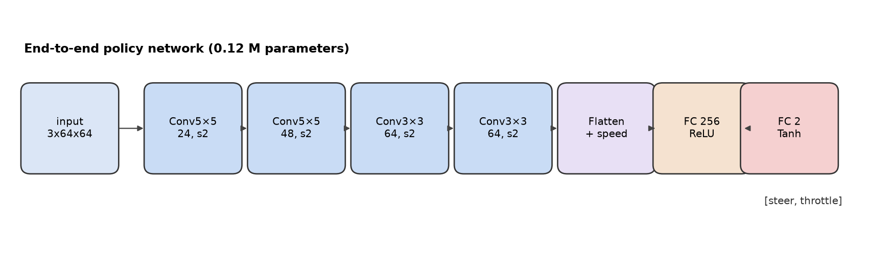
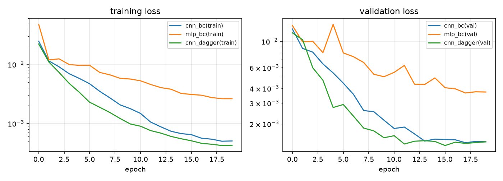

# 神经网络算法

本项目实现"感知 → 决策 → 控制"的全神经网络方案，包含两条技术路线：

1. **端到端**（作业任务 4）：单帧图像直接回归转向与油门；
2. **模块化**（作业任务 2/3 的感知与控制）：CNN 提取车道几何，规划器给出期望曲率与速度，
   底层控制器跟踪。

端到端策略是主方案；模块化结构在 [实验](experiments.md) 中作为对照讨论。

## 1. 端到端策略网络

### 1.1 输入与输出

| 项 | 规格 |
|---|---|
| 图像输入 | 64×64×3 RGB，归一化到 \([-1,1]\) |
| 状态输入 | 1 维：纵向车速 \(v_x/v_{\max}\) |
| 输出 | 2 维，\(\tanh\) 激活：\(u_{\text{steer}}\in[-1,1]\)、\(u_{\text{thr}}\in[-1,1]\) |
| 参数量 | 约 0.12 M（CNN） |

!!! question "为什么端到端还要输入车速？"
    单帧图像**无法区分"静止"与"高速巡航"**——同一段直道在 0 m/s 与 10 m/s 时画面几乎一样，
    但专家给出的油门完全不同（静止时 \(u_{\text{thr}}=1\)，巡航时约 0.3）。
    若只喂图像，网络只能学到条件期望 \(\mathbb{E}[u_{\text{thr}}\mid \text{image}]\)，
    在弯道处会输出负油门，导致车辆在起跑线"趴窝"。
    加入 1 维车速后该歧义消失，这也是实验章节中"纯图像基线"失败的原因。

### 1.2 网络结构

```text
Input 3×64×64
 ├─ Conv 5×5, 24, stride 2, ReLU     → 24×32×32
 ├─ Conv 5×5, 48, stride 2, ReLU     → 48×16×16
 ├─ Conv 3×3, 64, stride 2, ReLU     → 64×8×8
 ├─ Conv 3×3, 64, stride 2, ReLU     → 64×4×4
 ├─ Flatten                          → 1024
 ├─ Concat [v/vmax]                  → 1025
 ├─ FC 256, ReLU
 └─ FC 2, Tanh                       → [steer, throttle]
```



*图 1：端到端策略网络结构。四次 stride=2 卷积把 64×64 压缩到 4×4，感受野覆盖整幅图像。*

对照模型 `PolicyMLP` 把 64×64×3 直接展平为 12288 维接两层全连接（256→128），
参数量 3.1 M，用于验证"卷积的局部性与平移等变性是否必要"。

### 1.3 输出到执行器

\[
\delta=\delta_{\max}u_{\text{steer}},\qquad
a_{\text{cmd}}=
\begin{cases}
a_{\max}u_{\text{thr}}, & u_{\text{thr}}\ge0\\
a_{\text{brake}}u_{\text{thr}}, & u_{\text{thr}}<0
\end{cases}
\]

\(\delta_{\max}=0.55\) rad，\(a_{\max}=4\ \text{m/s}^2\)，\(a_{\text{brake}}=7\ \text{m/s}^2\)。

## 2. 专家策略（数据来源）

采用**纯跟踪（pure pursuit）** 生成专家轨迹。设车辆后轴中心为 \((x,y)\)，航向 \(\psi\)，
在中心线上取前视点 \(P=(x_t,y_t)\)，前视距离

\[
L_d=\operatorname{clip}(4.0+0.55\,v_x,\ 3,\ 11)\ \text{m}
\]

前视点在车体系下的横向偏差为 \(y_f\)、纵向为 \(x_f\)，则

\[
\alpha=\operatorname{atan2}(y_f,x_f),\qquad
\kappa=\frac{2\sin\alpha}{L_d},\qquad
\delta=\arctan(\kappa L)
\]

速度规划根据前方 14 m 内的最大曲率给出目标车速：

\[
v_{\text{target}}=\operatorname{clip}\left(\sqrt{\frac{a_{\text{lat}}}{|\kappa_{\text{ahead}}|}},\ 4,\ 12\right)
\]

油门用比例控制跟踪目标速度：

\[
u_{\text{thr}}=\operatorname{clip}\big(0.30+0.45\,(v_{\text{target}}-v_x),\ -1,\ 1\big)
\]

该专家在 227 m 赛道上单圈 22.1 s、平均 10.4 m/s、横向误差 RMSE 0.49 m，作为
"人类驾驶员"的替身生成监督信号。

## 3. 行为克隆（BC）

给定专家数据集 \(\mathcal{D}=\{(I_i,\mathbf{s}_i,\mathbf{a}_i)\}_{i=1}^{N}\)，最小化加权均方误差：

\[
\mathcal{L}(\theta)=\frac{1}{N}\sum_{i=1}^{N}
\Big[\big(\hat u_{\text{steer},i}-u_{\text{steer},i}\big)^2
+\lambda\big(\hat u_{\text{thr},i}-u_{\text{thr},i}\big)^2\Big],\qquad \lambda=0.6
\]

优化器 AdamW（\(\text{lr}=10^{-3}\)，weight decay \(10^{-4}\)），余弦退火 20–24 epoch，
batch 64，梯度裁剪 5.0。训练时做轻度光度增强（亮度 ×[0.85,1.15]、±12 灰度）提升光照鲁棒性。

### 3.1 数据采集

专家驾驶 5 圈 × 2 种光照（day、dusk），20 Hz 采样，共 **4137 帧**：

| 字段 | 形状 | 含义 |
|---|---|---|
| `images` | (N, 64, 64, 3) uint8 | 第一视角图像 |
| `actions` | (N, 2) float32 | 专家动作 [steer, throttle] |
| `states` | (N, 4) float32 | [v/vmax, 横向误差, 航向误差, 横摆角速度] |
| `scans` | (N, 64) float32 | 激光雷达（用于 SLAM/分析） |
| `scenes` | (N,) str | 场景标签 |

为增加状态覆盖，执行时以 12% 概率给转向叠加 \(\mathcal{N}(0,0.18)\) 扰动、6% 概率给油门
叠加 \(\mathcal{N}(0,0.25)\) 扰动；**标签始终是专家动作**，因此扰动带来了"偏离—纠正"样本。

## 4. DAgger：修复协变量偏移

行为克隆的致命问题是**分布偏移**：训练时看到的是专家状态分布 \(d_{\pi^*}\)，
测试时却运行在策略自己的状态分布 \(d_{\pi_\theta}\) 上，一旦偏离就进入未见过的状态。

DAgger 通过"策略跑、专家标"迭代扩充数据集：

\[
\mathcal{D}_k=\mathcal{D}_{k-1}\cup\big\{(I,\mathbf{s},\pi^*(\mathbf{s}))\ \big|\ \mathbf{s}\sim d_{\pi_{\theta_{k-1}}}\big\}
\]

实现细节：

- 用当前策略在仿真中行驶 4 圈，每步记录图像与该状态下的**专家动作**；
- 以 \(\beta=0.35\) 的概率执行专家动作（β-mixing），保证车辆不会因为策略太差而停在原地，
  同时让状态分布向专家分布靠拢；
- 每轮结束后在合并数据集上重新训练（2 轮）。

伪代码：

```text
D ← 专家演示数据
π ← Train(D)
for k in 1..K:
    D_new ← ∅
    s ← env.reset()
    while not done:
        a ← π(I(s), v(s))
        if rand() < β: a ← π*(s)          # β-mixing
        D_new ← D_new ∪ {(I(s), v(s), π*(s))}
        s ← env.step(a)
    D ← D ∪ D_new
    π ← Train(D)
return π
```

效果（详见[实验](experiments.md)）：单圈时间从 28.6 s 降到 22.4 s，平均车速从 8.0 m/s
升到 10.3 m/s，与专家的 10.4 m/s 基本持平。



*图 2：BC 与 DAgger 的训练/验证损失（对数坐标）。*

## 5. 推理与部署

```python
from mujoco_car_nn.cli import load_policy

policy = load_policy("runs/cnn_dagger.pt")   # CPU，1.5 ms/帧
action = policy(image_64x64, speed)           # -> [steer, throttle]
```

推理只依赖 `torch` + `numpy`，不依赖 MuJoCo；ROS 节点里就是这一行调用
（见 [ROS 部署](ros.md)）。CPU 单帧 1.5 ms，相对 50 ms 的控制周期有 30 倍余量。

## 6. 模块化方案（对照）

为回答"端到端是否必要"，项目还保留了可解释的模块化链路：

| 模块 | 输入 | 输出 | 实现 |
|---|---|---|---|
| 感知 | 64×64 图像 | 横向偏差 \(\hat e_y\)、航向偏差 \(\hat\psi_e\) | 小型 CNN 回归头（与策略网络共享骨干） |
| 规划 | \((\hat e_y,\hat\psi_e,v)\) | 期望曲率 \(\kappa_{\text{des}}\)、目标速度 | 纯跟踪解析式 + 曲率限速 |
| 控制 | \((\kappa_{\text{des}},v)\) | 转向、油门 | 横摆角速度伺服 + 速度 PI |

端到端方案把三者合成一个网络，省去了中间标注；模块化方案则可以直接读出"车辆认为
自己偏了多少"，便于调试。两者的定量对比见[实验](experiments.md)。
