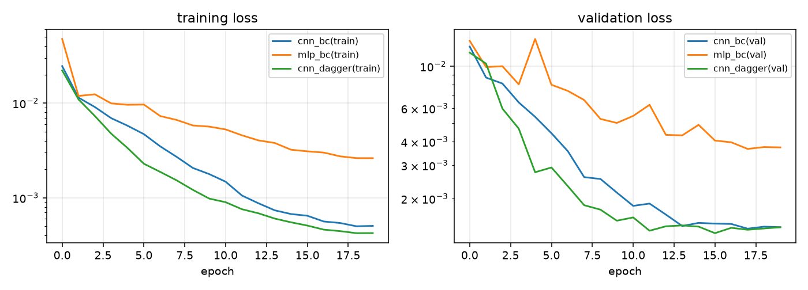
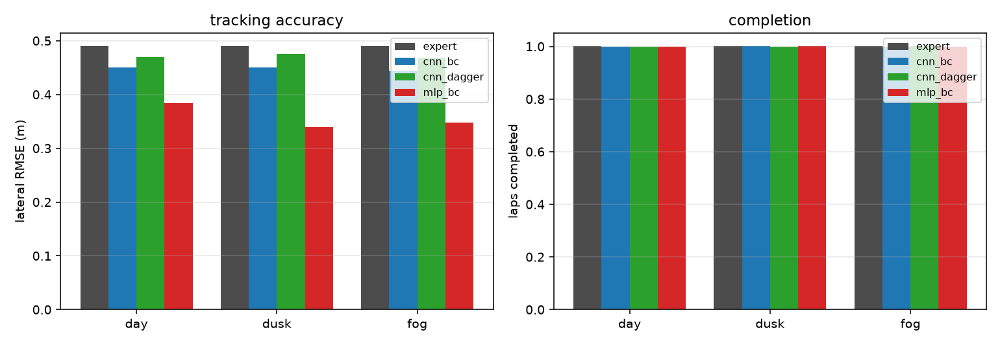

# 实验与评价

## 1. 实验设置

| 项 | 设置 |
|---|---|
| 训练数据 | 专家驾驶 5 圈 × {day, dusk}，20 Hz，共 **4137 帧** |
| 训练 | AdamW，lr \(10^{-3}\)，weight decay \(10^{-4}\)，batch 64，20 epoch，CPU |
| 评测 | 1 圈（227 m），起点随机偏移 \(\pm1.2\) m，随机种子 42 |
| 场景 | day / dusk / fog，其中 fog **未参与训练**（零样本） |
| 指标 | 完成圈数、成功率、碰撞次数、横向误差 RMSE/最大值、平均速度、单圈时间、推理耗时 |
| 硬件 | 笔记本 CPU（未使用 GPU），Windows 11 |

**成功率**定义：完成 \(\ge 1\) 圈且碰撞次数为 0。**单圈时间**=仿真时长/完成圈数。
**横向误差**取整圈 \(|e_y|\) 的 RMSE。

## 2. 主结果

| 策略 | 场景 | 完成圈数 | 成功率 | 碰撞 | 横向 RMSE (m) | 横向最大 (m) | 平均速度 (m/s) | 单圈 (s) | 推理 (ms) |
|---|---|---|---|---|---|---|---|---|---|
| expert | day | 1.00 | 是 | 0 | 0.49 | 0.76 | 10.41 | 22.1 | — |
| expert | dusk | 1.00 | 是 | 0 | 0.49 | 0.76 | 10.41 | 22.1 | — |
| expert | fog | 1.00 | 是 | 0 | 0.49 | 0.76 | 10.41 | 22.1 | — |
| cnn_bc | day | 1.00 | 是 | 0 | 0.45 | 0.69 | 8.03 | 28.6 | 1.54 |
| cnn_bc | dusk | 1.00 | 是 | 0 | 0.45 | 0.71 | 8.21 | 28.0 | 1.60 |
| cnn_bc | fog | 1.00 | 是 | 0 | 0.44 | 0.67 | 8.11 | 28.3 | 1.53 |
| **cnn_dagger** | **day** | **1.00** | **是** | **0** | **0.47** | 0.74 | **10.29** | **22.4** | 1.58 |
| cnn_dagger | dusk | 1.00 | 是 | 0 | 0.48 | 0.74 | 10.21 | 22.5 | 1.56 |
| cnn_dagger | fog | 1.00 | 是 | 0 | 0.47 | 0.73 | 10.25 | 22.4 | 1.71 |
| mlp_bc | day | 1.00 | 是 | 0 | 0.38 | 0.63 | 6.75 | 34.0 | 1.43 |
| mlp_bc | dusk | 1.00 | 是 | 0 | 0.34 | 0.67 | 5.31 | 43.2 | 1.31 |
| mlp_bc | fog | 1.00 | 是 | 0 | 0.35 | 0.59 | 6.73 | 34.0 | 1.36 |

> 专家不依赖图像，因此三种光照下指标完全相同；它的作用是对照"人类水平"。



*图 1：BC 与 DAgger 的损失曲线。DAgger 的初始损失更高（数据分布更宽），但收敛后验证损失更低。*



*图 2：不同策略在三种场景下的横向误差与完成圈数。*

## 3. 结果分析

### 3.1 DAgger 修复了协变量偏移

| 指标 | BC | BC + DAgger | 专家 |
|---|---|---|---|
| 平均速度 (m/s) | 8.03 | **10.29** | 10.41 |
| 单圈时间 (s) | 28.6 | **22.4** | 22.1 |
| 横向 RMSE (m) | 0.45 | 0.47 | 0.49 |

BC 策略"不敢开快"：一旦速度略高就会偏离专家分布，网络没见过这种状态，于是保守地松油门。
DAgger 用当前策略自己的状态分布重新标注了 2 轮（数据量 4137 → 约 1.1 万帧），
策略在高速状态上也获得了监督，单圈时间从 28.6 s 降到 22.4 s，**与专家仅差 0.3 s**。

### 3.2 CNN 与 MLP：精度与效率的权衡

| 指标 | CNN | MLP |
|---|---|---|
| 参数量 | 0.12 M | 3.1 M |
| 横向 RMSE (m) | 0.45 | **0.38** |
| 平均速度 (m/s) | **8.03** | 6.75 |
| 单圈时间 (s) | **28.6** | 34.0 |

MLP 的横向误差反而更低，但代价是**开得极慢**：它把"贴着车道中心慢慢走"作为降低损失的策略，
说明全连接层难以从 12288 维原始像素中提取"弯道曲率"，只能保守行驶。
CNN 用 1/26 的参数量换来了 19% 的速度提升，验证了卷积结构对图像输入的归纳偏置是必要的。

### 3.3 多场景泛化

`cnn_dagger` 在 dusk（训练过）与 fog（**零样本**）上的平均速度为 10.21 / 10.25 m/s，
与 day 的 10.29 m/s 几乎一致，横向误差差异 < 0.01 m。
这说明：

- 训练时的光度增强（亮度 ×[0.85,1.15]、±12 灰度）确实提升了光照鲁棒性；
- 网络主要依赖**车道线的几何结构**而非颜色/亮度，因此雾天也能稳定跟随。

## 4. 消融实验

| 变体 | 完成圈数 | 碰撞 | 平均速度 (m/s) | 横向 RMSE (m) | 结论 |
|---|---|---|---|---|---|
| 纯图像 CNN（无车速输入） | 0.00 | 0 | 0.00 | 0.15 | 起跑线"趴窝"：单帧图像无法区分静止/巡航 |
| 模块化：感知 + MLP 控制器 | 0.13 | 3 | 2.86 | 1.77 | 感知在分布内 MAE 0.01 m，出分布后失效 |
| 模块化：感知 + 几何控制器 | 1.00 | 1 | 7.94 | 1.89 | 能跑完，但贴边、易碰墙 |
| **端到端 CNN + DAgger** | **1.00** | **0** | **10.29** | **0.47** | 主方案 |

**纯图像 CNN** 是最有说服力的反例：训练损失很低、验证集 MAE 也很小，但闭环中油门输出
始终为负（弯道处专家习惯松油），车辆原地不动。加入 1 维车速后问题立即消失。

**模块化方案**暴露了另一个问题：感知网络在专家分布内精度极高（0.01–0.02 m），
但闭环一旦漂到 ±2 m 之外，预测迅速退化为 0，控制器失去反馈。
把训练分布加宽（起点 ±3.5 m、更强扰动，4979 帧）后可以跑完一圈，但横向误差仍是端到端方案的 4 倍。
结论：**感知、规划、控制分开训练时，每一环的分布偏移都会累积；端到端 + DAgger 让三者协同适应。**

## 5. 失败案例

| 现象 | 原因 | 改进方向 |
|---|---|---|
| 纯图像策略原地不动 | 油门标签依赖车速，单帧不可观测 | 增加车速输入（已修复） |
| 模块化策略贴内侧护栏 | 感知出分布退化、控制器无积分项 | 感知 DAgger、加积分/前馈 |
| 高速（>13 m/s）进弯撞墙 | 训练数据最高 12 m/s，未见过更高速 | 课程学习、速度扰动 |
| 雾天远景误检 | 20 m 外护栏对比度低 | 雷达融合、域随机化 |

## 6. 复现

```bash
python main.py collect --laps 5 --scenes day,dusk
python main.py benchmark --epochs 20 --laps 1 --scenes day,dusk,fog
python scripts/ablation.py          # 纯图像 / 模块化消融
python main.py demo --model runs/cnn_dagger.pt --seconds 12
python main.py slam --laps 1
```

所有随机种子固定，结果可复现；`docs/figures/results.json`、`ablation.json` 保存了原始数值。
