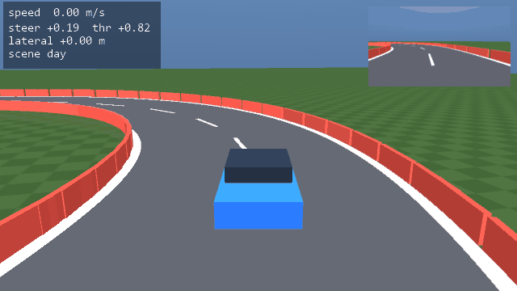
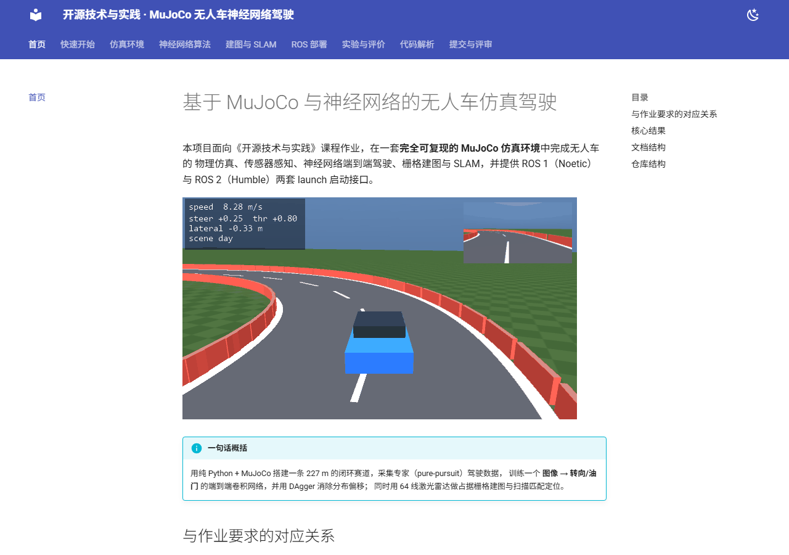
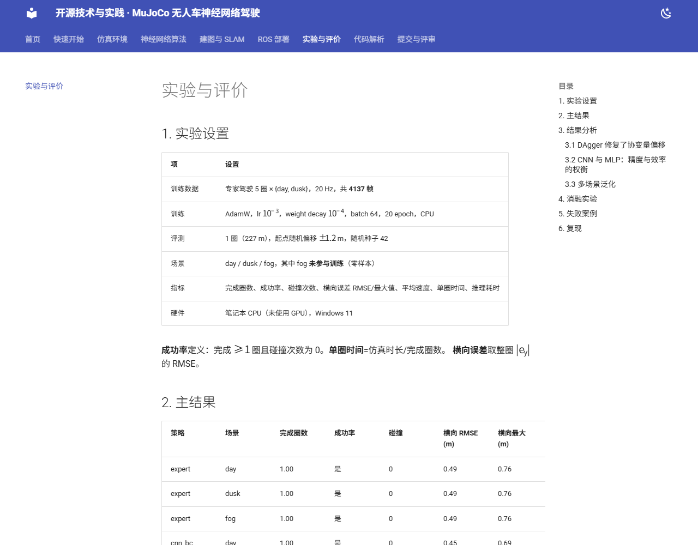

# 基于 MuJoCo 与神经网络的无人车仿真驾驶

本项目面向《开源技术与实践》课程作业，在一套**完全可复现的 MuJoCo 仿真环境**中完成无人车的
物理仿真、传感器感知、神经网络端到端驾驶、栅格建图与 SLAM，并提供 ROS 1（Noetic）与
ROS 2（Humble）两套 launch 启动接口。



!!! info "一句话概括"
    用纯 Python + MuJoCo 搭建一条 227 m 的闭环赛道，采集专家（pure-pursuit）驾驶数据，
    训练一个 **图像 → 转向/油门** 的端到端卷积网络，并用 DAgger 消除分布偏移；
    同时用 64 线激光雷达做占据栅格建图与扫描匹配定位。

## 与作业要求的对应关系

| 作业要求 | 本项目实现 | 代码 / 文档 |
|---|---|---|
| （1）物理仿真 + 键盘运动控制 | MuJoCo 平面刚体车辆（自行车模型 + 碰撞）、`main.py teleop`、ROS `car_teleop.launch` | [仿真环境](simulation.md) |
| （2）传感器感知 + 运动控制 | 车载 RGB 相机、64 线激光雷达、里程计；感知→决策→控制的闭环 | [神经网络算法](algorithm.md) |
| （3）建图与导航、SLAM 同步仿真 | 占据栅格建图 + 相关法扫描匹配定位，ATE / IoU 评价 | [建图与 SLAM](slam.md) |
| （4）端到端模型（图像→控制） | `PolicyCNN`：64×64 图像 + 车速 → 转向、油门 | [神经网络算法](algorithm.md) |
| 多场景测试 + 性能评价 | day / dusk / fog 三种光照，成功率、横向误差、单圈时间、推理耗时 | [实验与评价](experiments.md) |
| launch 启动 / Ubuntu 20.04 | ROS 1 Noetic 与 ROS 2 Humble 的 launch、节点、话题 | [ROS 部署](ros.md) |
| 同样模型不同算法、同样算法不同结构 | BC vs DAgger；CNN vs MLP | [实验与评价](experiments.md) |

## 核心结果

在 227 m 闭环赛道上行驶 1 圈，三种光照场景下均为 0 碰撞、100% 完成：

| 策略 | 平均速度 (m/s) | 单圈时间 (s) | 横向误差 RMSE (m) | 推理耗时 (ms) |
|---|---|---|---|---|
| 专家（pure pursuit） | 10.41 | 22.1 | 0.49 | — |
| 端到端 CNN（BC） | 8.03 | 28.6 | 0.45 | 1.6 |
| 端到端 CNN（BC + DAgger） | **10.29** | **22.4** | 0.47 | 1.5 |
| 端到端 MLP（BC） | 6.75 | 34.0 | 0.38 | 1.3 |

DAgger 把端到端策略的平均车速从 8.0 m/s 提升到 10.3 m/s，几乎追平专家（10.4 m/s），
验证了"单帧行为克隆存在协变量偏移、用专家在线标注可修复"这一结论。

## 文档结构

<div class="grid cards" markdown>

- :material-rocket-launch: **[快速开始](quickstart.md)**
  三条命令跑通：采集数据 → 训练 → 闭环评测。

- :material-car-side: **[仿真环境](simulation.md)**
  赛道参数方程、车辆动力学、相机与激光雷达建模。

- :material-brain: **[神经网络算法](algorithm.md)**
  CNN 结构、行为克隆损失、DAgger、pure-pursuit 专家。

- :material-map: **[建图与 SLAM](slam.md)**
  log-odds 栅格、射线投射、相关法扫描匹配、ATE / IoU。

- :material-robot: **[ROS 部署](ros.md)**
  Noetic 与 Humble 的编译、launch、话题与 TF。

- :material-flask: **[实验与评价](experiments.md)**
  多场景对比、消融、失败案例分析。

</div>

## 文档站点

本站点使用课程提供的 **hutb-doc**（OpenHUTB 维护的 mkdocs 分支）构建，`push` 到 `main`
后由 `.github/workflows/docs.yml` 自动发布到 GitHub Pages。





## 仓库结构

```text
ROS/
├── main.py                  # 统一入口：collect/train/eval/benchmark/demo/slam/teleop
├── src/mujoco_car_nn/       # 核心 Python 包
│   ├── sim.py               # MuJoCo 场景、车辆动力学、相机/雷达
│   ├── track.py             # 赛道几何与墙体生成
│   ├── expert.py            # pure-pursuit 专家
│   ├── dataset.py           # 数据采集与 Dataset
│   ├── models.py            # PolicyCNN / PolicyMLP
│   ├── train.py             # BC / DAgger 训练
│   ├── evaluate.py          # 闭环评测指标
│   ├── slam.py              # 栅格建图与扫描匹配
│   ├── viz.py               # HUD、GIF、地图渲染
│   └── cli.py               # 命令行接口
├── ros1/car_nn_sim/         # catkin 包（Noetic）
├── ros2/car_nn_sim/         # ament_python 包（Humble）
├── docs/                    # 本文档（mkdocs）
├── runs/                    # 训练产物（gitignore）
└── data/                    # 采集数据（gitignore）
```
