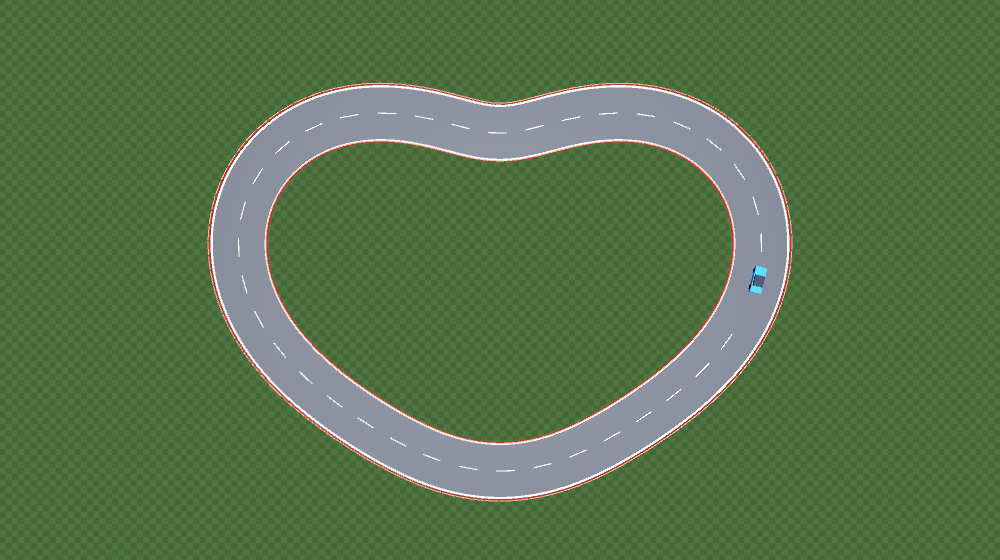
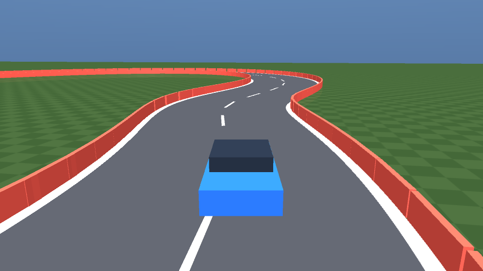
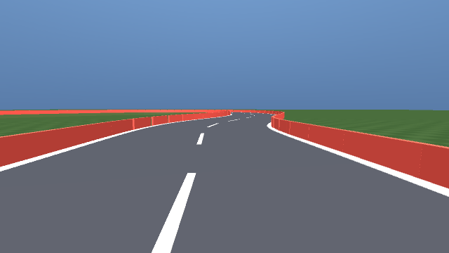
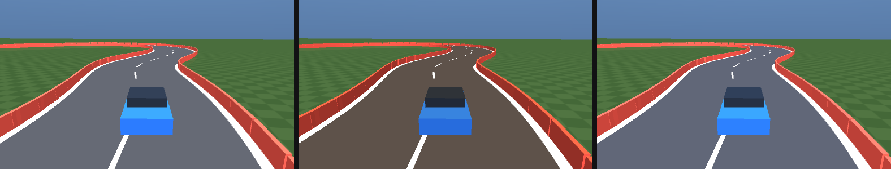

# 仿真环境

仿真在 **MuJoCo 4.0** 中离屏运行，不依赖 Gazebo / Carla / GPU，Windows 与 Ubuntu 均可直接跑通。
整个场景在启动时由 Python 动态生成 XML（约 275 个几何体），因此修改赛道、光照、车辆参数
都只需要改一处常量。

## 1. 场景组成

| 元素 | 实现 | 说明 |
|---|---|---|
| 地面 | `plane` + 程序化棋盘纹理 | 240 m × 240 m |
| 赛道 | `mesh` 四边形条带（沿中心线扫掠） | 宽 9 m，长 227 m |
| 车道线 | 白色 `mesh` 边线 + 虚线中心线 | 与中心线同源，绝不"错位" |
| 护栏 | 约 230 个 `box`，高 0.7 m | 真实碰撞 + 激光雷达反射面 |
| 车辆 | 平面刚体（2 滑块 + 1 铰链）+ 4 轮几何 | 1500 kg |
| 光照 | 平行光 + 天空盒 + 雾 | day / dusk / fog 三套参数 |



*图 1：赛道俯视图（MuJoCo 离屏渲染）。红色为护栏，白色为车道线，灰色为可行驶区域。*

## 2. 赛道几何

中心线采用极坐标下的光滑闭合曲线，保证曲率连续、无自交、最小转弯半径可解析控制：

\[
r(\theta) = R_0 + A\cos 2\theta + B\sin 3\theta,\qquad \theta\in[0,2\pi)
\]

\[
x(\theta)=r\cos\theta,\qquad y(\theta)=r\sin\theta
\]

取 \(R_0=34,\ A=7,\ B=3.5\)，得到周长 **227.1 m**、最小曲率半径 **15.5 m** 的赛道；
道路半宽 \(W/2=4.5\) m，因此弯道内侧仍有 11 m 的余量，车辆不会"转不过弯"。

曲率由离散转角估计并做 5 点滑动平均：

\[
\kappa_i=\frac{\Delta\theta_i}{\Delta s_i},\qquad
\Delta\theta_i=\operatorname{atan2}\big(t_i\times t_{i+1},\ t_i\cdot t_{i+1}\big)
\]

其中 \(t_i\) 为第 \(i\) 个采样点的单位切向量，\(\Delta s_i\) 为弧长增量。
中心线按 0.25 m 等弧长重采样（908 个点），左右法向偏移即可生成路面、边线与护栏。

!!! note "为什么不用贴图路面"
    贴图方案需要手工对齐纹理坐标，一旦赛道改动就会出现"车在草地上跑"的问题。
    本项目把路面、边线、护栏全部由同一条中心线**扫掠**生成，几何天然一致。

## 3. 车辆动力学

车辆被约束在水平面内运动：两个移动关节 \((x,y)\) 加一个绕 \(z\) 的铰链 \(\psi\)，
刚体只保留 3 个自由度，但**碰撞、接触力、质量、转动惯量仍由 MuJoCo 求解**。
这样可以避免四轮悬挂带来的数值刚性，同时保留"撞墙会减速并被弹开"的真实行为。

状态量 \(\mathbf{s}=(x,y,\psi,v_x,v_y,\omega)\)，其中 \(v_x,v_y\) 为车体系速度，\(\omega=\dot\psi\)。

**转向与横摆**（自行车模型 + 横摆角速度伺服）：

\[
\delta = \delta_{\max}\,u_{\text{steer}},\qquad
\omega_{\text{des}}=\frac{v_x\tan\delta}{L}
\]

\[
|\omega_{\text{des}}|\le \frac{a_{\text{lat,max}}}{\max(|v_x|,0.6)},\qquad
\tau_z = \operatorname{clip}\Big(I_z K_\omega(\omega_{\text{des}}-\omega),\ \pm\tau_{\max}\Big)
\]

其中 \(L=2.7\) m 为轴距，\(\delta_{\max}=0.55\) rad，\(a_{\text{lat,max}}=7\ \text{m/s}^2\)，
\(I_z=\frac{1}{12}m(L^2+W^2)\approx 2600\ \text{kg·m}^2\)，\(K_\omega=12\)。

**纵向**：

\[
F_x = m\,a_{\text{cmd}} - C_d\,v_x|v_x| - f_r\,m g\,\operatorname{sgn}(v_x)
\]

\[
a_{\text{cmd}}=
\begin{cases}
u_{\text{thr}}\,a_{\max}, & u_{\text{thr}}\ge 0\\
u_{\text{thr}}\,a_{\text{brake}}, & u_{\text{thr}}<0
\end{cases}
\]

并限制 \(v_x\le v_{\max}=16\) m/s、刹车不产生倒车（\(v_x\le0.05\) 时制动力置零）。

**横向**：用轮胎侧向阻尼近似侧偏力，并饱和到附着极限：

\[
F_y=\operatorname{clip}\big(-c_y m v_y,\ \pm \mu m g\big),\qquad c_y=9,\ \mu=1.0
\]

最后把车体系力变换到世界系，写入广义力：

\[
\begin{bmatrix}F_x^{w}\\F_y^{w}\end{bmatrix}
=\begin{bmatrix}\cos\psi&-\sin\psi\\ \sin\psi&\cos\psi\end{bmatrix}
\begin{bmatrix}F_x\\F_y\end{bmatrix},\qquad
\mathbf{q}_{\text{frc}}=[F_x^w,\ F_y^w,\ \tau_z]^{\top}
\]

MuJoCo 以 100 Hz 积分（`timestep=0.01`，每控制步 5 个子步），策略以 20 Hz 输出动作。



*图 2：第三人称跟车视角。车辆、护栏、车道线、路面均由参数化几何生成。*

## 4. 传感器建模

### 4.1 车载相机

相机安装在车头保险杠上方 \((1.45,\,0,\,0.85)\) m（相对车体中心），垂直视场角 \(70^\circ\)，
略微下俯 \(6^\circ\)，输出 **64×64 RGB** 供网络使用；同时可渲染 320×180 用于演示。

相机朝向用四元数精确给出：MuJoCo 相机沿自身 \(-z\) 方向观察、\(+y\) 为上，
因此车体系下相机坐标轴为

\[
R_c=\begin{bmatrix}
0&0&-1\\ -1&0&0\\ 0&1&0
\end{bmatrix}
\]

即"右 = 车身 \(-y\)，上 = 车身 \(+z\)，后 = 车身 \(-x\)"。



*图 3：64×64 网络输入的放大显示（最近邻插值）。*

### 4.2 激光雷达

64 束、水平 360°、量程 20 m，安装高度 0.6 m（低于 0.7 m 护栏，保证能打到）。
每一束调用 MuJoCo 的射线求交：

```python
dist = mujoco.mj_ray(model, data, origin, direction,
                     geomgroup=[0, 1, 0, 0, 0, 0],  # 只与护栏求交
                     flg_static=True, bodyexclude=-1, geomid=geomid)
```

单帧 64 束耗时约 **0.24 ms**，完全满足 20 Hz 实时。雷达数据用于
[建图与 SLAM](slam.md)。

### 4.3 里程计

仿真器给出真值速度 \(v_x\) 与横摆角速度 \(\omega\)，SLAM 节点对其乘以
\((1+\mathcal{N}(0,\sigma^2))\) 的乘性噪声（默认 \(\sigma=1.5\%\)）模拟轮速计/IMU，
用于验证扫描匹配能否抑制里程计漂移。

## 5. 多场景光照

通过修改平行光的 `diffuse/ambient` 与雾浓度实现三种场景，用于检验网络对光照的鲁棒性：

| 场景 | 光照颜色 | 环境光 | 雾浓度 | 用途 |
|---|---|---|---|---|
| day | (1.00, 0.98, 0.92) | 0.45 | 0.05 | 训练 / 主实验 |
| dusk | (1.00, 0.72, 0.45) | 0.30 | 0.18 | 训练 / 泛化测试 |
| fog | (0.85, 0.88, 0.92) | 0.50 | 0.45 | **零样本**测试 |



*图 4：day / dusk / fog 三种光照下的同一路段。*

## 6. 仿真操作步骤

### 6.1 Windows 原生（推荐用于开发）

```powershell
cd ROS
python main.py demo --model runs/cnn_dagger.pt --seconds 14 --fps 10
```

执行后终端会打印 GIF 路径；用浏览器或图片查看器打开即可看到
"第三人称 + 第一视角小窗 + HUD"的演示。若想自己开：

```powershell
python main.py teleop --scene day
```

会弹出 MuJoCo 原生窗口，按 `W/S` 加速/刹车、`A/D` 转向、空格停车、`Q` 退出。

### 6.2 Ubuntu 20.04 + ROS Noetic

```bash
cd ~/catkin_ws/src && ln -s /path/to/ROS ros_car_nn
cd ~/catkin_ws && catkin_make && source devel/setup.bash
roslaunch car_nn_sim car_teleop.launch          # 键盘遥控
roslaunch car_nn_sim car_nn.launch policy:=/path/to/runs/cnn_dagger.pt
roslaunch car_nn_sim car_slam.launch            # 建图
```

详细话题、TF 与 RViz 配置见 [ROS 部署](ros.md)。

### 6.3 运行截图说明

| 步骤 | 观察到的现象 |
|---|---|
| 启动 `demo` | 车辆从起点出发，HUD 显示 speed / steer / lateral |
| 进入弯道 | 网络提前打方向，车辆保持在车道中心 ±0.5 m |
| 撞墙测试 | 车辆被护栏弹回、速度骤降，碰撞计数 +1（评测中统计） |
| `slam` | 右侧地图随行驶逐渐展开，红色点为当前帧雷达点 |

## 7. 性能

| 项目 | 数值 | 测试环境 |
|---|---|---|
| 物理步进 | 100 Hz（5 子步 × 20 Hz 控制） | i7 / Ryzen 笔记本 CPU |
| 64×64 相机渲染 | 0.7 ms / 帧 | 同上 |
| 64 束雷达 | 0.24 ms / 帧 | 同上 |
| 单圈仿真（227 m） | 22 s 仿真时间 ≈ 1.2 s 墙钟 | 同上 |
| 端到端推理 | 1.5 ms / 帧（CPU，单线程） | torch 2.x |

仿真速度约为实时的 **15–20 倍**，因此一次完整的 20 epoch 训练 + 12 次闭环评测可在
10 分钟内完成。
