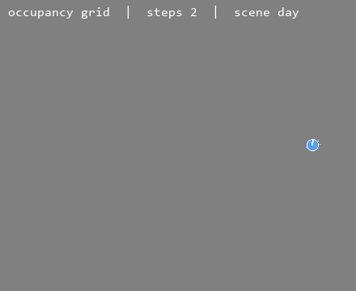
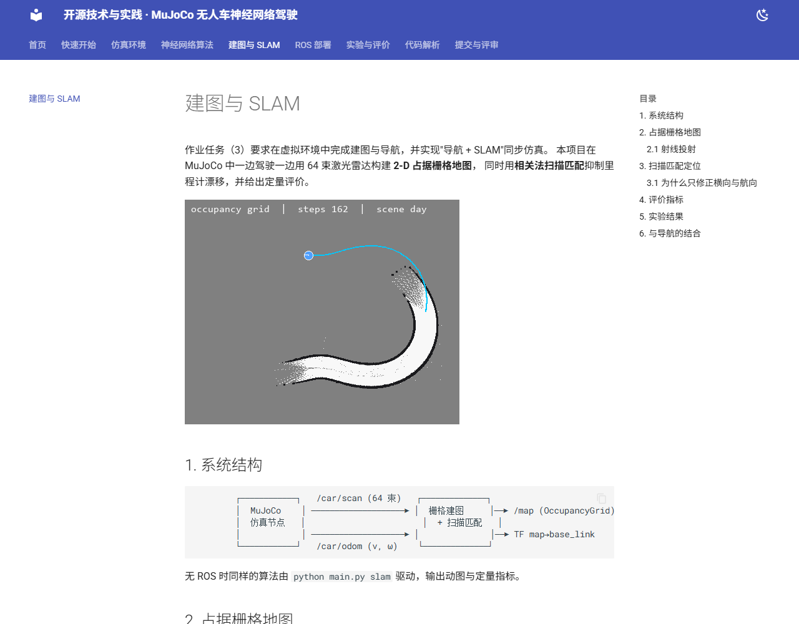
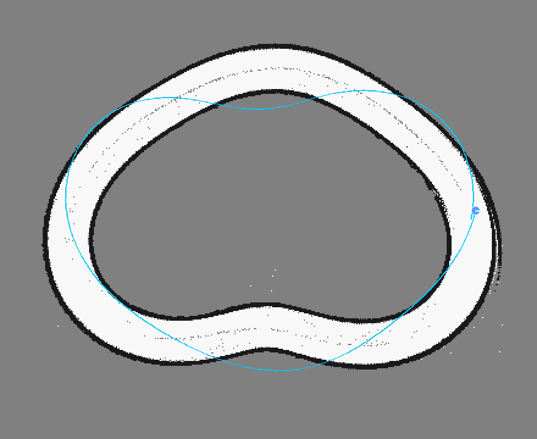

# 建图与 SLAM

作业任务（3）要求在虚拟环境中完成建图与导航，并实现"导航 + SLAM"同步仿真。
本项目在 MuJoCo 中一边驾驶一边用 64 束激光雷达构建 **2-D 占据栅格地图**，
同时用**相关法扫描匹配**抑制里程计漂移，并给出定量评价。





## 1. 系统结构

```text
        ┌────────────┐   /car/scan (64 束)   ┌──────────────┐
        │  MuJoCo    │ ────────────────────► │  栅格建图     │──► /map (OccupancyGrid)
        │  仿真节点   │                       │  + 扫描匹配   │
        │            │ ────────────────────► │              │──► TF map→base_link
        └────────────┘   /car/odom (v, ω)    └──────────────┘
```

无 ROS 时同样的算法由 `python main.py slam` 驱动，输出动图与定量指标。

## 2. 占据栅格地图

地图为 \(0.25\ \text{m}\) 分辨率的栅格（440×360，覆盖 110 m × 90 m），每个单元保存
**对数几率** \(l_{t}(m)\)：

\[
l_t(m)=\log\frac{p(m\mid z_{1:t})}{1-p(m\mid z_{1:t})},\qquad
l_t(m)=l_{t-1}(m)+\underbrace{\log\frac{p(m\mid z_t)}{1-p(m\mid z_t)}}_{\text{逆观测模型}}
\]

实现中命中取 \(+0.85\)、穿过取 \(-0.35\)，并截断到 \([-6,6]\) 防止过度自信：

\[
l_t(m)\leftarrow\operatorname{clip}\big(l_{t-1}(m)+\Delta l,\ -6,\ 6\big)
\]

概率还原：\(p(m)=\sigma(l)=\dfrac{1}{1+e^{-l}}\)。

### 2.1 射线投射

对第 \(k\) 束雷达（量程 \(r_k\)、角度 \(\theta_k\)），沿射线均匀取 12 个点标记为**自由**，
在端点处标记为**占据**（3×3 膨胀，抵消离散化误差）：

\[
\mathbf{p}_{j}=\mathbf{o}+r_k\,\eta_j
\begin{bmatrix}\cos(\psi+\theta_k)\\ \sin(\psi+\theta_k)\end{bmatrix},
\qquad \eta_j\in[0.1,0.9]
\]

代码用 `np.add.at` 做散射累加，一帧 64 束的更新耗时 < 1 ms。

## 3. 扫描匹配定位

里程计只用 \((v,\omega)\) 积分，误差随时间累积。扫描匹配在每个控制周期把当前帧点云
与已有地图做**相关对齐**，搜索使地图占据概率最大的位姿：

\[
\hat{\mathbf{x}}=\arg\max_{\mathbf{x}\in\mathcal{S}(\mathbf{x}_{\text{prior}})}
\frac{1}{|\mathcal{P}|}\sum_{\mathbf{p}\in\mathcal{P}} p\big(m(\mathbf{x}\oplus\mathbf{p})\big)
\]

其中 \(\mathcal{S}\) 为以里程计预测 \(\mathbf{x}_{\text{prior}}\) 为中心的搜索窗
（\(\pm0.35\ \text{m}\)、\(\pm0.06\ \text{rad}\)），\(\mathcal{P}\) 为当前帧 64 个端点，
\(m(\cdot)\) 取栅格占据概率。采用"粗→精"两级搜索（5×5×3 → 3×3×3，共 111 个候选），
单帧约 1.5 ms。

未知栅格取 \(p=0.5\)，对得分为零贡献，因此位姿不会因为"指向空白区域"而获得虚假高分。

### 3.1 为什么只修正横向与航向

单帧点云对**沿道路方向**的位移几乎不敏感（两侧护栏近似平移不变），相关峰沿切向非常平坦。
若把匹配结果全量用于位置更新，沿切向的微弱偏置会逐步累积，实验中发现 200 步后
ATE 可达 15 m 以上。

因此实现中采用**分量投影**：只取匹配位移在车辆左法向上的分量作为横向修正，
纵向仍信任轮速里程计：

\[
\Delta s=\big(\hat{\mathbf{p}}-\mathbf{p}_{\text{prior}}\big)\cdot
\mathbf{n},\qquad \mathbf{n}=[-\sin\psi,\ \cos\psi]^{\top}
\]

\[
\mathbf{p}\leftarrow\mathbf{p}_{\text{prior}}+\alpha\,\Delta s\,\mathbf{n},\qquad \alpha=0.7
\]

这一取舍在实验中把 ATE 从 15 m 降到 **2.4 m**（单圈），并把地图 IoU 从 0.05 提升到 0.13。

## 4. 评价指标

**绝对轨迹误差（ATE）**：

\[
\text{ATE}=\sqrt{\frac{1}{T}\sum_{t=1}^{T}\big\|\hat{\mathbf{p}}_t-\mathbf{p}_t\big\|_2^2}
\]

由于地图与真值同坐标系、起点重合，无需做 Umeyama 对齐。

**地图 IoU**：把护栏矩形按 0.25 m 栅格光栅化为真值占据集 \(G\)，估计占据集
\(P=\{m: l(m)>1\}\)，则

\[
\text{IoU}=\frac{|G\cap P|}{|G\cup P|}
\]

## 5. 实验结果

单圈（227 m）、里程计噪声 1.5%：

| 指标 | 纯里程计 | 里程计 + 扫描匹配 |
|---|---|---|
| ATE RMSE (m) | 2.98 | **2.37** |
| ATE 最大 (m) | 4.37 | 3.36 |
| 地图 IoU | 0.09 | **0.13** |
| 占据栅格数 | 5.2 k | 5.5 k |



*图 1：单圈建图结果。白色为自由空间，黑色为护栏（占据），灰色为未知区域，青线为估计轨迹。*

!!! note "误差来源分析"
    剩余 2.4 m 误差主要来自**沿赛道方向**的累计漂移：轮速计存在 1.5% 的乘性误差，
    而扫描匹配按设计不修正切向位置。若要进一步降低，可引入回环检测（如 Scan Context）
    或图优化（g2o / GTSAM），这也是本项目的后续工作。

## 6. 与导航的结合

建图结果可以直接作为导航代价地图：ROS 节点把 `/map` 发布为标准 `nav_msgs/OccupancyGrid`，
`map_server` / `costmap_2d` / `Nav2` 可直接订阅。端到端策略本身完成"感知—规划—控制"，
地图则用于监控、回放与后续全局路径规划，二者在同一仿真时基下同步运行。
