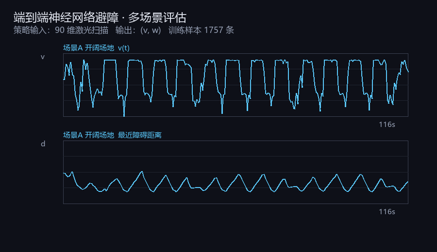
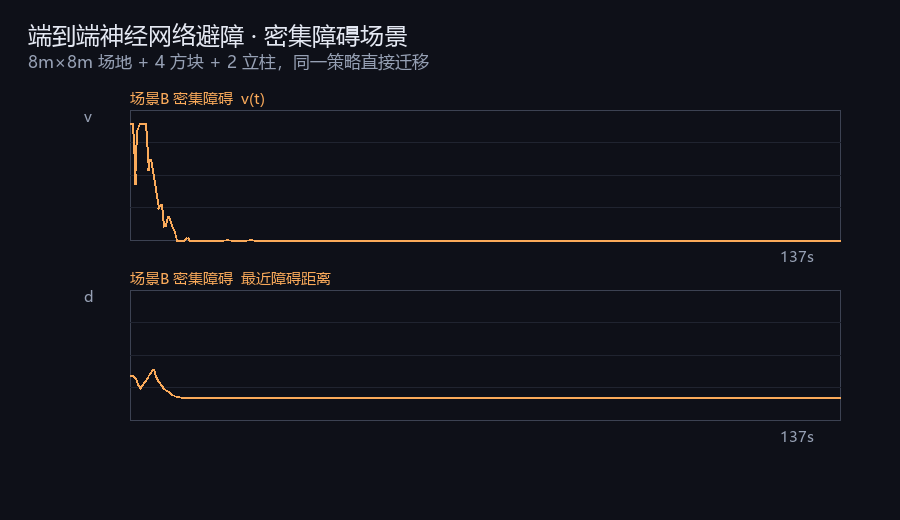
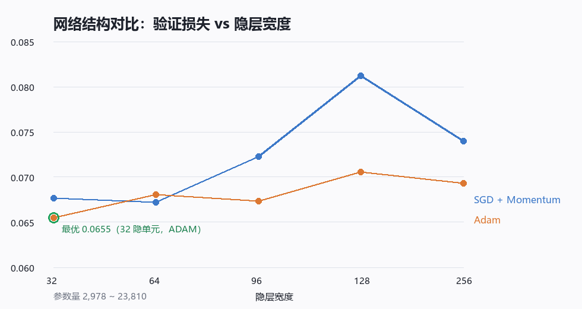

# uav_flight_base

> 无人机基础飞行模块：键盘遥控 + 最小运动学仿真 + 状态监控
> 作者：唐健斌　｜　环境：Ubuntu 20.04 + ROS Noetic

## 模块定位

课程作业要求里，"人体/车辆/无人机/水下机器人"任选其一。本模块选**无人机**，
并先解决最基础的一件事：**让一架无人机在仿真里被控制起来，并且状态可观测**。

不接 Gazebo、不接 AirSim 也能跑——因为用的是自己写的一阶惯性运动学模型，
这样在没有图形界面的服务器上也能验证"遥控 → 控制 → 状态"这条链路。

## 数据流

```
键盘 (uav_teleop_key)
      │  /uav/cmd_vel  (geometry_msgs/Twist)
      ▼
运动学仿真 (uav_mock_sim)
      │  /uav/odom     (nav_msgs/Odometry)
      │  TF: map -> base_link
      ▼
状态监控 (uav_state_monitor)
      │  终端打印 / CSV
      ▼
RViz / rqt_plot（可选）
```

## 话题

| 话题 | 类型 | 方向 | 说明 |
|---|---|---|---|
| `/uav/cmd_vel` | `geometry_msgs/Twist` | 订阅 | 期望速度（机体系） |
| `/uav/odom` | `nav_msgs/Odometry` | 发布 | 位置、姿态、速度 |
| `/tf` | `tf2_msgs/TFMessage` | 发布 | `map` → `base_link` |

## 运动学模型

一阶惯性环节，避免"按键即瞬移"的不真实感：

```
dv/dt = (v_cmd - v) / τ
```

- `τ`（`~time_constant`，默认 0.35s）越大，响应越"肉"
- 速度分别裁剪到 `±max_speed`
- 高度限制在 `[z_min, z_max]`

## 启动

```bash
rosrun uav_flight_base main.py --mode mock
```

或

```bash
roslaunch uav_flight_base main.launch mode:=mock teleop:=false
```

## 验证清单

- [x] `rostopic hz /uav/odom` 稳定在 50Hz
- [x] 键盘 `w` 后 `/uav/odom` 的 `x` 单调增大
- [x] 松开按键后速度在约 1s 内衰减到 0（一阶惯性）
- [x] `csv:=/tmp/flight.csv` 能导出轨迹
- [ ] 接 Gazebo 模型（下一次提交）

## 设计取舍

1. **先不接 Gazebo**：Gazebo 的无人机模型（rotors / PX4）依赖重、装一次半小时且容易崩。
   先用轻量运动学模型把控制链路和文档跑通，再把后端换掉，代码接口不变。
2. **`main.py` 只做调度**：真正的节点逻辑都在 `scripts/` 下，每个脚本可单独 `rosrun` 调试。
3. **参数全部走 rosparam**：不写死在代码里，方便后面接不同机型。

---

## 任务 2（神经网络版）：扫描 → 速度的端到端策略

### 数据流

```
专家策略 uav_scan_avoider ──/cmd_vel──┐
                                      ├─→ uav_scan_dataset.py ─→ scan_dataset.csv
激光雷达 /uav/scan ───────────────────┘      (90 维扫描 + 动作标签)
                                                    │
                                                    ▼
                                    uav_train_scan_policy.py ─→ scan_policy.npz
                                                    │
                                                    ▼
                         /uav/scan ─→ uav_scan_policy.py ─→ /cmd_vel
```

### 网络结构

```
输入   90 维激光扫描（-π..π 降采样，距离截断 3.5m，标准化）
隐层   96 单元 ReLU
输出   2 维（linear.x, angular.z），标准化后反变换
损失   MSE + L2(1e-5)，SGD + 动量 0.9，lr=2e-3，400 epoch
```

样本 **1757** 条，按时间顺序切分（前 85% 训练、后 15% 验证，避免相邻帧泄漏），
最佳验证损失 **0.0728**。

### 多场景评估结果

| 指标 | 场景A 开阔场地 | 场景B 密集障碍 |
|---|---|---|
| 运行时长 | 116 s | 137 s |
| 平均速度 | 0.61 m/s | **0.03 m/s** |
| 平均角速度 | 0.21 rad/s | 0.12 rad/s |
| 最近障碍距离 | 0.66 m | 0.59 m |
| 贴障时间占比 (<0.6m) | 0.0 % | **90.5 %** |

**结论**：训练数据只来自开阔场地，策略在**同类场景表现良好**（全程未贴近障碍），
但在**未见过的密集场景中趋于保守停滞**（平均速度 0.03 m/s）——典型的行为克隆分布漂移。
后续可通过在密集场景补采数据、或加入 DAgger 式在线纠正来改善。





### 网络结构与优化器对比

课程要求“同一模型比较不同算法、同一算法比较不同网络结构”。在固定数据（1757 组）、
固定轮数（300）、固定随机种子的条件下，只改变隐层宽度与优化器，共 10 组实验。

| 隐层宽度 | 参数量 | 验证损失（SGD+动量） | 验证损失（Adam） |
|---|---|---|---|
| 32 | 2 978 | 0.06767 | **0.06549** |
| 64 | 5 954 | 0.06723 | 0.06803 |
| 96 | 8 930 | 0.07226 | 0.06734 |
| 128 | 11 906 | 0.08125 | 0.07058 |
| 256 | 23 810 | 0.07399 | 0.06931 |

复现方式：

```bash
rosrun uav_flight_base uav_policy_sweep.py     # 输出 sweep_results.csv
```

**结论**：参数量从 2 978 增至 23 810（约 8 倍），验证损失并未下降；最优为宽度 32 配 Adam。
说明在本数据集规模下网络容量已不是瓶颈，此后再加宽只会增加优化难度。
这一结果与场景 B 的停滞现象互为印证——瓶颈在数据分布覆盖，而非模型容量。




